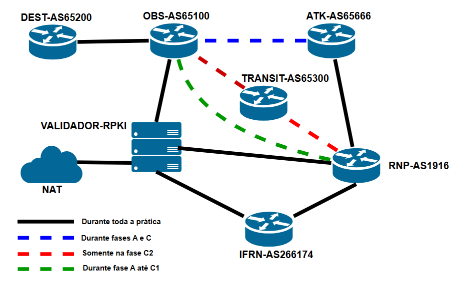

# Topologia do testbed

| Linha | Significado |
|---|---|
| Preta contínua | enlace ativo durante toda a prática |
| Azul tracejada | enlace ATK–OBS, ativo nas Fases A e C |
| Verde tracejada | enlace RNP–OBS, ativo da Fase A até o cenário C1 |
| Vermelha tracejada | TRANSIT (AS65300), presente somente no cenário C2 |

O validador (Routinator) fica no switch `10.1.0.0/24`, de onde atende os
roteadores por RTR, e é o único nó com saída para a Internet (NAT), usada para
sincronizar com os repositórios dos RIRs. O endereçamento de cada enlace está
no [README principal](../README.md#topologia).
